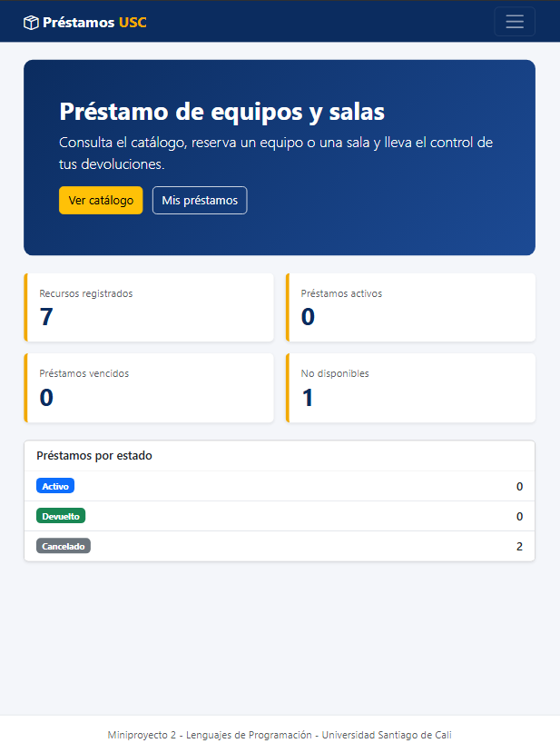
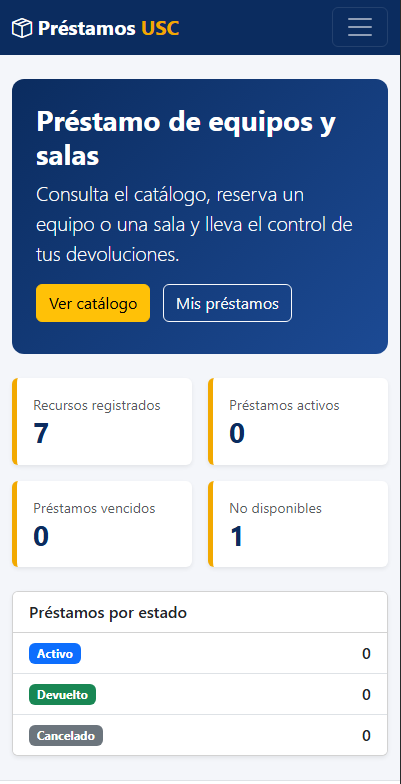
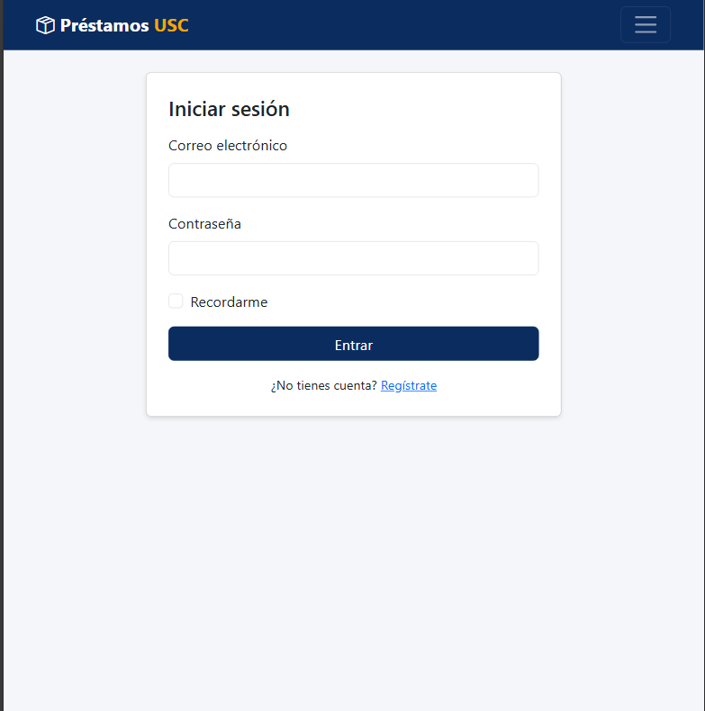
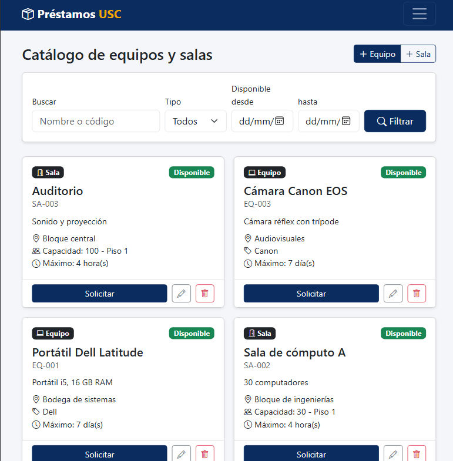
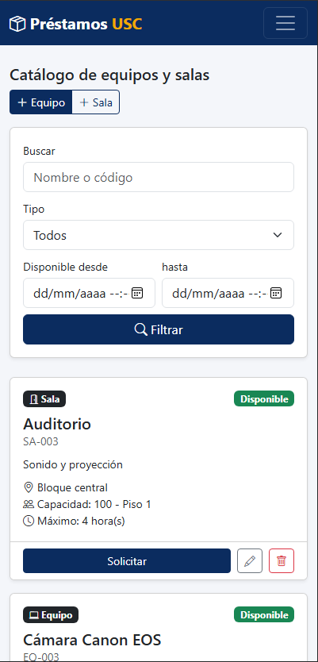
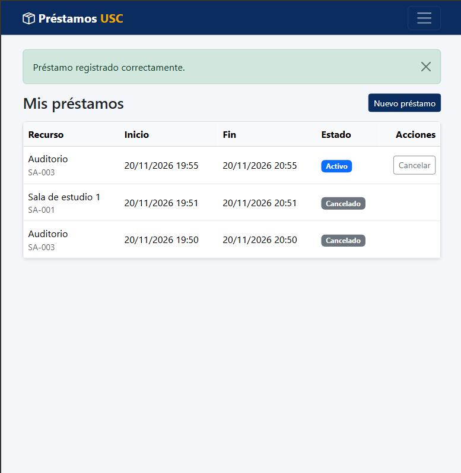
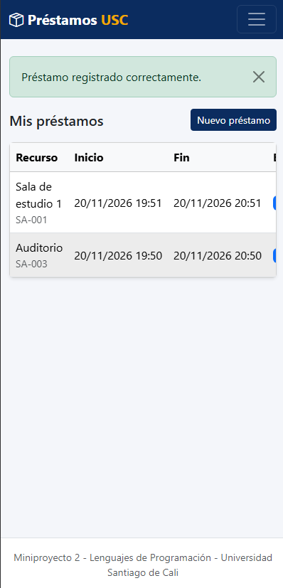

# Informe técnico: PrestamosUSC

Sistema de préstamo de recursos (equipos y salas) de la USC.
Repositorio: Alejo427/Prestamos-USC · Plataforma: .NET 8 · ASP.NET Core MVC · EF Core · SQLite

---

## 1. Arquitectura en capas

La solución separa la lógica de negocio de la interfaz, de modo que la web y la futura app de escritorio reutilicen el mismo código.

| Proyecto | Responsabilidad |
|---|---|
| `PrestamosUSC.Core` | Biblioteca de clases con toda la lógica: entidades, enumeraciones, excepciones, repositorios, servicios, extensiones y acceso a datos (`AppDbContext`, migraciones). |
| `PrestamosUSC.Web` | Aplicación ASP.NET Core MVC: controladores, vistas Razor, autenticación e inicialización de la base de datos. |
| `PrestamosUSC.Desktop` | (Pendiente) Aplicación Windows Forms que consumirá los mismos servicios de Core. |

### Capas dentro de Core

```
Web / Desktop  (presentación)
      │  usan interfaces
      ▼
Services       IPrestamoService, IRecursoService  →  reglas de negocio
      │
      ▼
Repositories   IRepositorio<T>                    →  acceso genérico a datos
      │
      ▼
Data           AppDbContext (EF Core + SQLite)    →  persistencia
```

- **Entities / Enums:** `Recurso` (con subtipos `Equipo` y `Sala`), `Prestamo`, `EstadoRecurso`, `EstadoPrestamo`.
- **Services:** `PrestamoService` y `RecursoService` concentran las reglas. Los controladores no duplican lógica.
- **Repositories:** `IRepositorio<T>` ofrece operaciones CRUD genéricas (`ObtenerPorIdAsync`, `AgregarAsync`, `ActualizarAsync`, `EliminarAsync`).
- **Exceptions:** `ReglaNegocioException` y `RecursoOcupadoException` comunican violaciones de reglas a la capa de presentación.
- **Extensions:** métodos de extensión como `Estado.Texto()` y `TimeSpan.ToTextoLegible()` para mostrar datos en español.

Los servicios se inyectan por constructor (inyección de dependencias), lo que desacopla las capas y facilita las pruebas.

## 2. Reglas de negocio

Implementadas en `PrestamoService.RegistrarAsync`:

1. La fecha de fin debe ser posterior a la de inicio.
2. No se puede registrar un préstamo en el pasado (con una tolerancia en minutos definida en `ReglasPrestamo.ToleranciaMinutosFechaPasada`).
3. El recurso debe existir y estar en estado **Disponible** (no en mantenimiento ni fuera de servicio).
4. La duración no puede superar el máximo del tipo de recurso: **Equipo, 7 días; Sala, 4 horas** (`DuracionMaximaPrestamo`).
5. Un usuario puede tener como máximo **3 préstamos activos** (`ReglasPrestamo.MaxPrestamosActivosPorUsuario`).
6. Un recurso no puede tener dos préstamos activos que se traslapen. Hay traslape cuando `inicioExistente < finNuevo && finExistente > inicioNuevo`; si ocurre se lanza `RecursoOcupadoException`.

Otras reglas:

- **Devolver:** cambia el estado a `Devuelto` y registra `FechaDevolucion`.
- **Cancelar:** solo si el préstamo aún no ha comenzado; si ya empezó, debe usarse "Devolver".
- **Permisos:** solo el dueño del préstamo o un administrador pueden devolver o cancelar, y solo si el préstamo está `Activo`.
- **Recursos:** el código es único (se normaliza con `Trim().ToUpperInvariant()`). No se puede eliminar un recurso con historial de préstamos; se debe marcar como "Fuera de servicio".
- **Roles:** el sistema distingue entre Administrador y Estudiante. El administrador puede gestionar los préstamos de cualquier usuario; el estudiante solo los suyos.

## 3. Estructuras de datos: justificación y comparación

| Estructura | Dónde se usa | Por qué |
|---|---|---|
| `List<T>` | Resultados de `ListarAsync`, `ListarPorUsuarioAsync`, `ListarTodosAsync` | Colección ordenada, de tamaño variable, con acceso por índice O(1) y recorrido secuencial. Es el resultado natural de `ToListAsync()` y se enlaza directo con las vistas. |
| `HashSet<int>` | `idsOcupados` en el filtro "disponible entre dos fechas" | Se necesita saber si el Id de un recurso está ocupado. `Contains` es O(1) promedio y elimina duplicados (un recurso puede tener varios préstamos). |
| `Dictionary<EstadoPrestamo, int>` | `ResumenDashboard` (conteo de préstamos por estado) | Asocia clave (estado) con valor (cantidad) y permite consultar un estado en O(1). |
| `IQueryable<T>` | Construcción de consultas en `ListarAsync` | Permite componer filtros (tipo, búsqueda, estado) y traducirlos a una sola consulta SQL en lugar de filtrar en memoria. |

### Comparación

**`List<int>` vs `HashSet<int>` para los Ids ocupados.** Con una `List`, cada `Contains` recorre los elementos (O(n)), así que filtrar *m* recursos cuesta O(m·n). Con `HashSet` cuesta O(m + n). Con pocos recursos la diferencia es mínima, pero el `HashSet` escala mejor y expresa la intención ("conjunto de ocupados, sin repetidos").

**`Dictionary` vs `List` de pares para el resumen.** Una lista de pares exige recorrerla para hallar un estado (O(n)); el diccionario accede directo por clave (O(1)) y garantiza una sola entrada por estado.

**Costo de memoria.** `HashSet` y `Dictionary` usan algo más de memoria que una `List` por la tabla hash. Aquí los volúmenes son pequeños, así que el costo es despreciable frente a la ganancia en claridad y velocidad.

## 4. Características de C# utilizadas

- **Programación asíncrona (`async`/`await`, `Task<T>`):** todo el acceso a datos es asíncrono para no bloquear hilos (`RegistrarAsync`, `ListarAsync`, etc.).
- **LINQ y expresiones lambda:** `Where`, `OrderBy`, `GroupBy`, `Select`, `Any`, `Count`, `ToDictionaryAsync`; EF Core las traduce a SQL.
- **Interfaces e inyección de dependencias:** `IPrestamoService`, `IRecursoService`, `IRepositorio<T>`.
- **Genéricos:** `IRepositorio<T>` evita repetir el CRUD por cada entidad.
- **Herencia y polimorfismo:** `Equipo` y `Sala` heredan de `Recurso`, cada uno con su duración máxima; se consultan con `OfType<Equipo>()` / `OfType<Sala>()`.
- **Delegados y eventos:** `PrestamoEventHandler`, `PrestamoRegistrado` y `PrestamoDevuelto` notifican a otras partes del sistema sin acoplarlas. `PrestamoDevuelto` también se dispara al cancelar, para avisar a la lista de espera de que el recurso quedó libre.
- **Métodos de extensión:** `Texto()` y `ToTextoLegible()` en el espacio de nombres `Extensions`.
- **Excepciones personalizadas:** `ReglaNegocioException` y `RecursoOcupadoException` separan los errores de negocio de los técnicos.
- **Tipos anulables (`string?`, `DateTime?`, `Recurso?`):** expresan parámetros opcionales y resultados que pueden no existir.
- **Operadores `??` y `?.`:** `?? throw new ...` para validar existencia e `Invoke` seguro con `PrestamoRegistrado?.Invoke(...)`.
- **Constructores con expresión (`=>`)** y **cadenas interpoladas (`$"..."`)** para mensajes claros.
- **Entity Framework Core:** `Include`, `AsNoTracking` y migraciones para persistencia en SQLite.

## 5. Capturas responsive

Las capturas están en `docs/capturas/`: pantallas principales en ancho de **tablet (~768 px)** y de **celular (~390 px)**.

| Pantalla | Tablet | Celular |
|---|---|---|
| Inicio | `inicio-tablet.png` | `inicio-celular.png` |
| Inicio de sesión | `login-tablet.png` | `login-celular.png` |
| Listado de recursos | `recursos-tablet.png` | `recursos-celular.png` |
| Mis préstamos | `prestamos-tablet.png` | `prestamos-celular.png` |

### Inicio





### Inicio de sesión




### Listado de recursos





### Mis préstamos




